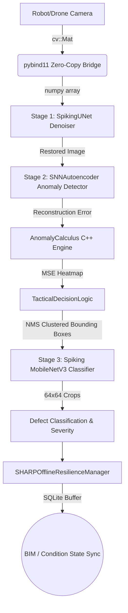

# Civil Infrastructure & Structural Health Monitoring Architecture

## System Overview
This project adapts battlefield SNN architectures for civil infrastructure inspection, providing a robust, three-stage SNN pipeline capable of running on resource-constrained edge devices (Jetson, Raspberry Pi 5, Intel NUC) mounted on crawling robots or drones.



## Key design decisions explained

| Decision | Rationale |
|---|---|
| SpikingUNet with V_mem Readout | Preserves sub-millimeter hairline crack edges critical for structural safety assessment, avoiding destructive discretization. |
| Negative-Only SNNAutoencoder Training | Circumvents the need for exhaustive defective training data; naturally flags anomalies (corrosion, cracks, spalling, weld defects) via high reconstruction error. |
| Multi-Stage Defect Classification | Separating anomaly detection from classification reduces compute load by only extracting fixed 64x64 ROIs for the classifier, achieving ≥10 FPS. |
| SHARPOfflineResilienceManager | Enables uninterrupted inspection telemetry buffering in tunnels or underground pipelines with zero connectivity, auto-syncing upon surface return. |

> [!IMPORTANT]
> The Stage 2 SNNAutoencoder must be trained on strictly negative-only data. The inclusion of even a single defective sample in the training set will compromise anomaly detection sensitivity.

> [!NOTE]
> Ensure the C++ pybind11 bridge relies on zero-copy semantics to maintain real-time processing on low-power devices.

## Export Deliverables

- `sunet_denoiser_static_T4.onnx` - Stage 1 denoiser exported with static temporal unrolling.
- `snn_autoencoder_static_T4.onnx` - Stage 2 anomaly detector.
- `spiking_mobilenet_classifier_static_T4.onnx` - Stage 3 defect classifier.
- `calibration_data/` - Static inputs used for ONNX node quantization and baseline testing.
- `deploy_inference.py` - End-to-end Python script utilizing the C++ extension bridge.

## Shared Infrastructure

| Component | Implementation File | Usage in Pipeline |
|---|---|---|
| SpikingUNet (S-UNet) | `models/stage1_denoiser/model.py` | Stage 1 Denoiser (LIF, β=0.85, V_mem readout, SpikingConvBlock) |
| Corruption Engine | `models/stage1_denoiser/corruption.py` | Simulates glare, blur, and droplet artifacts during training |
| SNNAutoencoder | `models/stage2_detector/autoencoder.py` | Stage 2 Negative-Only Anomaly Detector (Camouflage Piercer) |
| MobileNetV3 Classifier | `models/stage3_classifier/model.py` | Stage 3 Multi-Label Defect Classifier (6-Class CODEBRIM) |
| AnomalyCalculus | `src_cpp/include/anomaly_calculus.hpp` | Pixel-wise MSE heatmap generation in C++ |
| TacticalDecisionLogic | `src_python/tactical_logic.py` | Morphological filtering, contour extraction, and NMS clustering |
| SHARP Resilience Manager | `src_python/sharp_resilience.py` | Offline SQLite telemetry buffering and background auto-sync |
| pybind11 Bridge | `src_cpp/src/pybind_bridge.cpp` | Zero-copy cv::Mat ↔ numpy transfer via py::array_t |

## Suggested Project Structure

```text
infrastructure_inspection/
├── models/
│   ├── stage1_denoiser/    # SpikingUNet repurposed for extreme environment image restoration
│   ├── stage2_detector/    # SNNAutoencoder for negative-only defect flagging
│   └── stage3_classifier/  # Spiking MobileNetV3 for defect categorization
├── src_cpp/                # AnomalyCalculus and pybind11 zero-copy bridge
├── src_python/             # TacticalDecisionLogic and SHARPOfflineResilienceManager
├── data/
│   ├── synthesis/          # Corruption Engine scripts for simulating camera artifacts
│   └── datasets/           # Scripts for CODEBRIM, SDNET2018, Crack500, DAGM
├── export/                 # ONNX static temporal unrolling scripts
└── docs/                   # AASHTO / API 570 / ASME B31.3 compliance mapping
```

> [!CAUTION]
> The SNN LIF decay rates (β=0.85) and surrogate gradient slopes (Fast Sigmoid, slope=25) are tightly tuned. Modifying `SpikingConvBlock` or `SpikingTransConvBlock` architecture requires recalibrating these hyperparameters.
