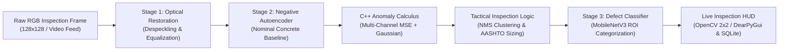

<div align="center">

# Infraspect

**Autonomous Civil Infrastructure & Structural Health Monitoring (SHM)**  
*Real-Time Edge Inspection via Spiking Neural Networks (SNN) & Continuous Deep Learning*

[](https://github.com/wwwrryyy/infraspect/actions/workflows/ci.yml)
[](https://github.com/wwwrryyy/infraspect/releases/tag/v1.0.0)
[](https://www.python.org/)
[](LICENSE)
[%20%7C%20CNN%20(T%3D1)-purple.svg)](#comparative-architectural-benchmark)

</div>

---

## Overview

**Infraspect** is an edge-first autonomous inspection engine designed for unmanned aerial vehicles (UAVs) and field robotics surveying civil concrete structures (bridges, tunnels, retaining walls, pavements).

It processes 3-channel RGB inspection feeds through a modular three-stage edge pipeline, providing real-time surface restoration under optical corruptions, unsupervised anomaly localization, automated ROI defect classification, and physical millimeter crack width estimation mapped to **AASHTO MBEI 1130 Condition States (CS1–CS4)**.

The system natively supports two interchangeable architectures:
1. **Spiking Neural Network (SNN, $T=4$ timesteps):** Unrolled Leaky Integrate-and-Fire (LIF) dynamics delivering superior anomaly contrast and noise rejection.
2. **Continuous CNN ($T=1$ single-pass):** High-throughput edge inference delivering up to **242 FPS** on low-power silicon.

---

## Core Architecture



### Three-Stage Pipeline
- **Stage 1 (Optical Restoration):** ResUNet / SpikingUNet denoiser trained against civil atmospheric corruptions (airborne dust, sea fog, lens vignetting, and salt-and-pepper noise).
- **Stage 2 (Negative-Only Anomaly Detector):** Autoencoder trained strictly on nominal, uncracked concrete textures. Structural defects (cracks, spalls) produce high reconstruction residuals without requiring millions of labelled anomalies.
- **Stage 3 (Defect Classifier):** MobileNetV3 classifier evaluating detected bounding boxes against the 6-class CODEBRIM civil damage taxonomy (*Background, Crack, Spalling, Corrosion Stain, Efflorescence, Exposed Rebars*).
- **C++ Engine (`src_cpp/`):** PyBind11 zero-copy `cv::Mat` bridge executing pixel-wise multi-channel anomaly calculus and Gaussian smoothing with sub-millisecond execution ($<0.25\text{ ms}$).

---

## Comparative Architectural Benchmark

Measured on Apple M5 silicon across 10 inspection iterations at $128\times 128$ resolution:

| Metric / Stage | SNN ($T=4$ Timesteps) | Continuous CNN ($T=1$) | Speedup | Notes |
| :--- | :--- | :--- | :--- | :--- |
| **Stage 1 Denoiser Latency** | $8.74\text{ ms}$ | **$2.52\text{ ms}$** | **$3.5\times$** | $T=4$ LIF convs vs. single-pass ResUNet |
| **Stage 2 Anomaly Latency** | $4.85\text{ ms}$ | **$1.05\text{ ms}$** | **$4.6\times$** | Sparse membrane potential vs. ConvAutoencoder |
| **C++ Anomaly Calculus** | $0.21\text{ ms}$ | **$0.20\text{ ms}$** | $1.0\times$ | Multi-channel squared error + Gaussian kernel |
| **Stage 3 Classifier (ROIs)** | $0.14\text{ ms}$ | **$0.07\text{ ms}$** | $1.9\times$ | MobileNetV3 on aspect-padded $64\times 64$ crops |
| **Total End-to-End Latency** | $14.27\text{ ms}$ | **$4.12\text{ ms}$** | **$3.5\times$** | Full frame ingestion $\to$ HUD overlay $\to$ DB sync |
| **Sustained Frame Rate** | **$70.1\text{ FPS}$** | **$242.5\text{ FPS}$** | **$3.5\times$** | Real-time edge processing |
| **PRD Requirement ($\ge 10\text{ FPS}$)** | **MET ($70\text{ FPS}$)** | **EXCEEDED ($243\text{ FPS}$)** | - | Both architectures exceed edge real-time criteria |

---

## Real Civil Concrete Datasets & Empirical AUROC

The models are trained and calibrated on over **40,000 real civil concrete images**:
1. **METU Concrete Crack Benchmark (`bimewok_cracks`):** 40,000 real images ($227\times 227$) with 20,000 uncracked concrete textures and 20,000 crack samples.
2. **CrackForest Dataset:** 118 high-resolution road and bridge surfaces with human-annotated MATLAB `.mat` segmentation masks.
3. **CrackSegmentation Dataset:** 84 high-resolution concrete structures.

### Empirical Validation Results

| Model / Stage | CNN Backbone ($T=1$) | SNN Backbone ($T=4$) | Target Benchmark |
| :--- | :--- | :--- | :--- |
| **Stage 1 Denoiser Loss** | **$0.0211$** | **$0.0251$** | Continuous restoration under corruptions |
| **Stage 2 Validation Loss** | **$0.000575$** | **$0.001053$** | Unsupervised nominal concrete baseline |
| **Stage 2 Ground-Truth Pixel AUROC** | **$0.8677$** | **$0.9515$** | Evaluated on real human ground-truth masks |
| **Stage 3 Defect Accuracy** | **$98.9\%$** | **$95.1\%$** | 6-class CODEBRIM taxonomy on real crops |
| **Calibrated 99.5th %ile Threshold** | **$0.00274$** | **$0.00279$** | Zero-leakage held-out validation set |

---

## Advisory AASHTO MBEI 1130 Condition States

Physical crack width is computed in real time using the optical Ground Sample Distance ($\text{GSD} = 0.08\text{ mm/pixel}$ by default):

$$\text{Crack Width (mm)} = \text{Bounding Box Minor Axis (px)} \times \text{GSD (mm/px)}$$

| Condition State | Description | Width Threshold | HUD Overlay Color | Action Guidance |
| :--- | :--- | :--- | :--- | :--- |
| **CS1 (Good)** | Hairline cracking | $< 0.3\text{ mm}$ | **Green** | Nominal surface; routine monitoring |
| **CS2 (Fair)** | Moderate cracking | $0.3\text{ mm} - 1.25\text{ mm}$ | **Yellow** | Scheduled sealing / maintenance |
| **CS3 (Poor)** | Severe cracking | $1.25\text{ mm} - 2.0\text{ mm}$ | **Orange** | Active structural repair warranted |
| **CS4 (Critical)**| Structural compromise | $> 2.0\text{ mm}$ | **Red** | Urgent structural engineering review |

---

## Installation & Quick Start

### 1. Prerequisites
- Python 3.10, 3.11, or 3.12
- CMake $\ge 3.20$ & C++17 compiler (`clang++` or `g++`)
- OpenCV C++ library (`libopencv-dev` on Ubuntu / `brew install opencv` on macOS)

### 2. Setup Environment
```bash
# Clone the repository
git clone https://github.com/wwwrryyy/infraspect.git
cd infraspect

# Create and activate virtual environment
python3 -m venv .venv
source .venv/bin/activate

# Install dependencies
pip install -r requirements.txt

# Compile the C++ PyBind11 acceleration engine
cmake -B src_cpp/build -S src_cpp
cmake --build src_cpp/build --config Release
```

### 3. Launch the Interactive Inspection HUD
```bash
# Launch OpenCV 2x2 Multi-Panel HUD (Default)
python gui_dashboard.py --gui cv --arch cnn

# Launch Native DearPyGui Desktop Dashboard
python gui_dashboard.py --gui dpg --arch snn

# Headless CI Verification (runs 10 frames without opening display windows)
python gui_dashboard.py --gui cv --headless --frames 10
```

### 4. Interactive Keyboard Controls
| Key | Function |
| :--- | :--- |
| **`[C]` / `[Tab]`** | Hot-swap between SNN ($T=4$) and CNN ($T=1$) backbones with instant model reload |
| **`[+]` / `[=]`** | Increase sensitivity (lowers MSE anomaly threshold) |
| **`[-]` / `[_]`** | Decrease sensitivity (raises MSE anomaly threshold) |
| **`[G]`** | Toggle physical crack width estimation via Ground Sample Distance (GSD) |
| **`[Space]`** | Freeze / unfreeze live video stream |
| **`[S]`** | Capture high-resolution timestamped diagnostic snapshot to disk |
| **`[Q]` / `[Esc]`** | Clean shutdown with buffered SQLite commit |

---

## AASHTO Civil Inspection Audit Reporting

Infraspect includes a standalone audit report generator that queries the edge telemetry SQLite buffer and outputs self-contained, responsive HTML dashboards, native vector PDF documents, and structured JSON summaries:

```bash
# Generate executive inspection HTML dashboard & JSON summary
infraspect-report --db civil_inspection_telemetry.db --asset-id "Bridge Pier #4B - North Span" --output inspection_report.html --json-output inspection_report.json

# Generate native multi-page vector PDF report directly
infraspect-report --db civil_inspection_telemetry.db --output inspection_report.pdf
```

- **Standards Mapping:** Directly aligns detected crack widths and spalls to **AASHTO MBEI Section 1130 (CS1 to CS4)**.
- **Surface Area & Coverage:** Computes scanned surface area in square meters and total analyzed frames from drone telemetry poses.
- **Embedded Visualizations:** Offline SVG condition state donut chart, defect category bar charts, and inline visual ROI thumbnail crops.
- **Executive Action Plan:** Automatically prescribes maintenance guidance (routine monitoring, elastomeric injection, or immediate structural engineer review).
- **Dual Export:** Standalone printable HTML report (`@media print`) and zero-dependency vector PDF 1.4 output.

---

## Automated Verification & Testing

The repository includes **41 automated unit tests** covering C++ bindings, anomaly calculus parity, optical corruption determinism, neural network forward passes, real dataset extraction, headless GUI loops, and AASHTO report generation.

```bash
# Run complete test suite
pytest tests/ -v
```

All tests run automatically on every push via **GitHub Actions** (`.github/workflows/ci.yml`).

---

## Pre-Compiled Models

Production ONNX model graphs and empirical calibration profiles are provided in `exports/`:
- `exports/cnn_denoiser.onnx` & `exports/sunet_denoiser_static_T4.onnx`
- `exports/cnn_autoencoder.onnx` & `exports/snn_autoencoder_static_T4.onnx`
- `exports/cnn_mobilenet_classifier.onnx` & `exports/spiking_mobilenet_classifier_static_T4.onnx`
- `exports/calibration_cnn.json` & `exports/calibration_snn.json`

---

## License

Distributed under the **MIT License**. See [`LICENSE`](LICENSE) for details.
